# Cookie Crumbles - Responsive Website

**Student:** Lethabo Mabolawa (ST1540397)
**Module:** WEDE
**GitHub:** https://github.com/LethaboMabolawa/WEDEPOE

A six-page website for Cookie Crumbles Bakery, built with HTML and CSS only. It uses a **mobile-first** approach: the base styles are for phones, and media queries add layout for tablets and desktops.

## Files

| File | Purpose |
|---|---|
| `index.html`, `about.html`, `shop.html`, `blog.html`, `faq.html`, `contact.html` | The six pages |
| `style.css` | The single stylesheet linked from every page |
| `images/` | Each image in 3 widths (400, 800, 1200px) as `.webp` and `.jpg`, plus a square hero crop for phones |
| `screenshots/` | Evidence of each page at desktop, tablet and phone sizes |

## 3.1 Breakpoints

| Name | Screen width | Media query | Layout |
|---|---|---|---|
| Small phone | under 480px | `max-width: 29.99em` | Full-width buttons, tighter table padding |
| Mobile | up to 767px | base styles (no query) | Single column, hamburger menu, square hero image |
| Tablet | 768px and up | `min-width: 48em` | Horizontal nav, 2-column cards, side-by-side content, 2x2 footer |
| Desktop | 992px and up | `min-width: 62em` | 3-column cards, hero text beside image, 4-column footer |

Breakpoints are written in `em` so they also respond to a user's browser font size (1em = 16px by default).

**Multi-column to single-column:** the product, blog and testimonial cards use CSS Grid with 3 columns on desktop, 2 on tablet and 1 on mobile. The About and Contact pages use Flexbox with `flex-direction: row` on tablet and above, and `column` on mobile. The footer goes from 4 columns to 2x2 to 1 column.

**Font sizes per breakpoint:** the type scale is stored as CSS variables and re-defined inside each media query.

| Element | Mobile | Tablet | Desktop |
|---|---|---|---|
| h1 | 2rem | 2.441rem | 3.052rem |
| h2 | 1.75rem | 2rem | 2.441rem |
| h3 | 1.5rem | 1.563rem | 1.953rem |
| Lead text | 1.125rem | 1.125rem | 1.25rem |
| Body | 1rem | 1rem | 1rem |

**Navigation per breakpoint:** on mobile the links are hidden behind a hamburger button that opens a vertical menu (built with a hidden checkbox and a label, so no JavaScript is needed). From tablet width the hamburger is hidden and the links sit in a horizontal bar. The header is sticky at every size.

## 3.2 Relative units

- All font sizes, spacing, borders, radii, icon sizes and button widths are in `rem` (for example `--space-2: 1rem`, `.hero-buttons .btn { width: 12rem }`).
- The page container is `width: 92%` with `max-width: 75rem`, so it always fills the screen on small devices and stops growing on large ones.
- Images, form fields, cards and the table use `width: 100%`, so they fit whatever space they are in.
- Pixels are only used for 1px borders and hairlines.

## 3.3 Responsive images

Every image is supplied in three widths and two formats:

- `srcset` with width descriptors (`400w`, `800w`, `1200w`) lets the browser choose the smallest file that still looks sharp.
- `sizes` tells the browser how wide the image will be displayed (for example `(min-width: 62em) 30vw, (min-width: 48em) 45vw, 92vw` for the product cards).
- `<picture>` offers a WebP version first (smaller file) with a JPEG fallback for older browsers.
- **Art direction on the home page:** on screens under 768px the hero uses a tighter square crop (`hero-square-*`); on tablet and desktop it uses the wide version.
- `width` and `height` attributes reserve space so the page does not jump as images load, and `loading="lazy"` delays images below the fold.

The images are currently illustrated cookie placeholders. To use real photos, export each one at 400, 800 and 1200px wide as `.jpg` and `.webp`, keep the same file names, and the HTML will work without changes.

## 3.4 Testing

The site was tested using Chromium's device emulation (the same engine as the Chrome DevTools device toolbar) at the sizes below. No page scrolls sideways at any of these sizes.

| Device | Viewport | Layout used |
|---|---|---|
| Desktop | 1440 x 900 | Desktop |
| iPad Pro (portrait) | 1024 x 1366 | Desktop |
| iPad Air | 820 x 1180 | Tablet |
| iPhone 12 Pro | 390 x 844 | Mobile |
| iPhone SE | 375 x 667 | Small phone |

### Screenshots - Home page

**Desktop (1440 x 900)**
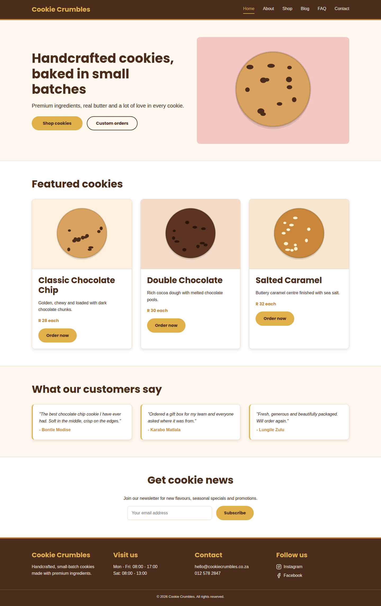

**iPad Pro (1024 x 1366)**
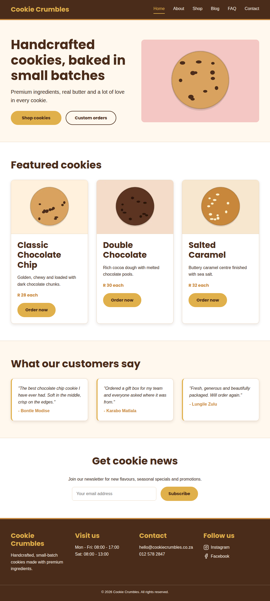

**iPad Air (820 x 1180)**
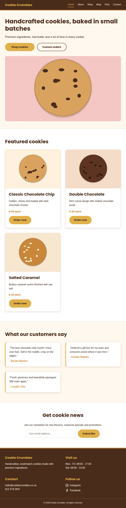

**iPhone 12 Pro (390 x 844)**
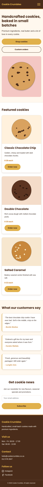

**iPhone 12 Pro with the menu open**
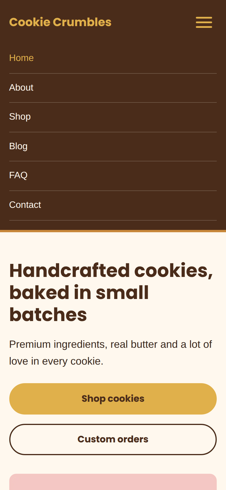

**iPhone SE (375 x 667)**
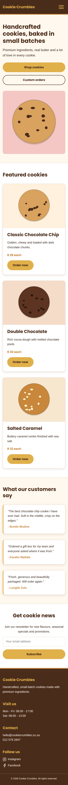

### Screenshots - Other pages

| Page | Desktop | Tablet | Mobile |
|---|---|---|---|
| About | 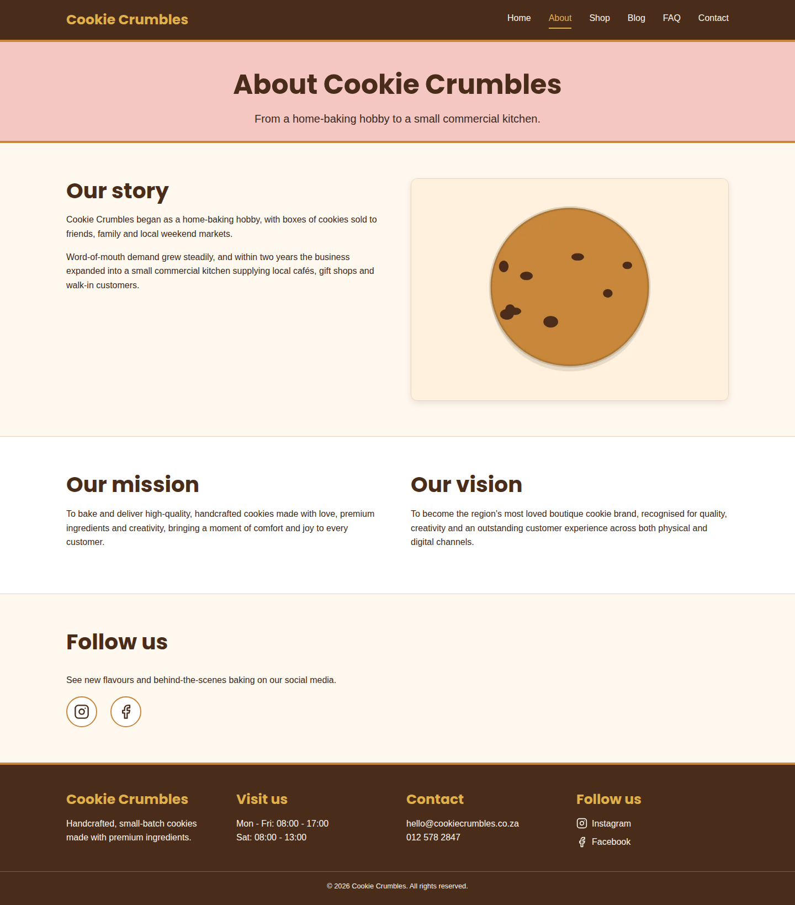 | 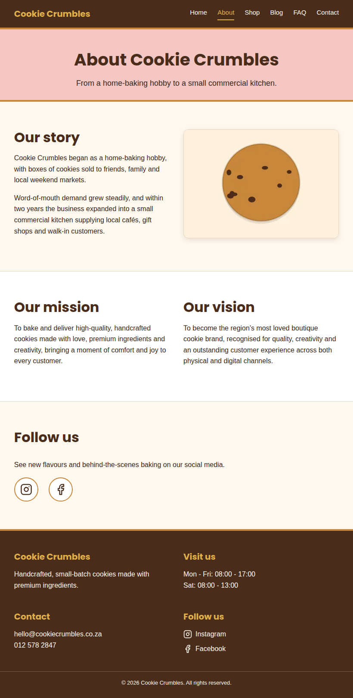 | 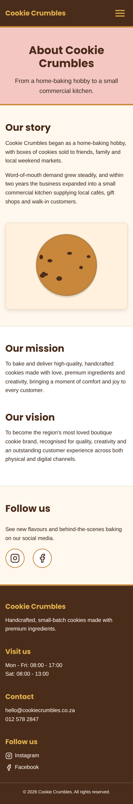 |
| Shop | 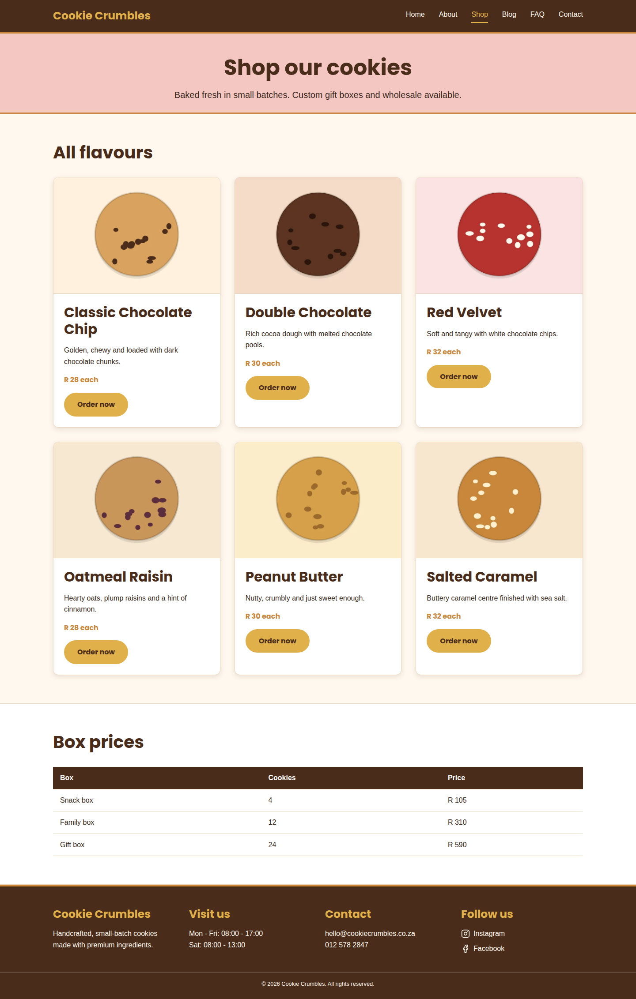 | 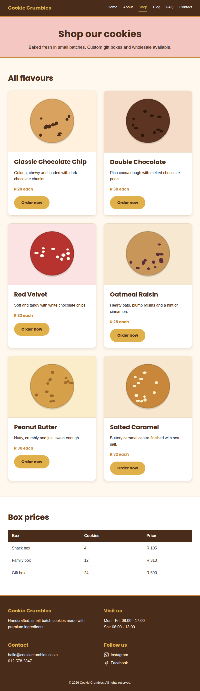 | 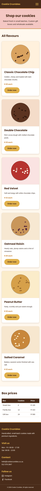 |
| Blog | 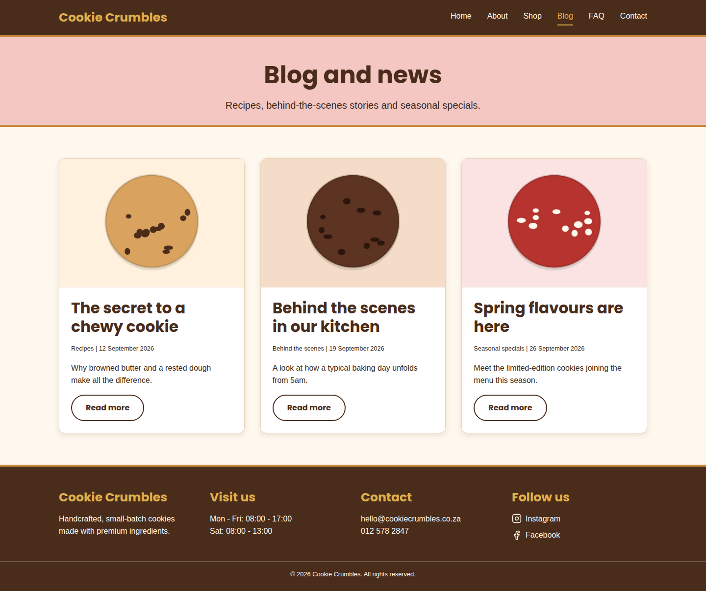 | 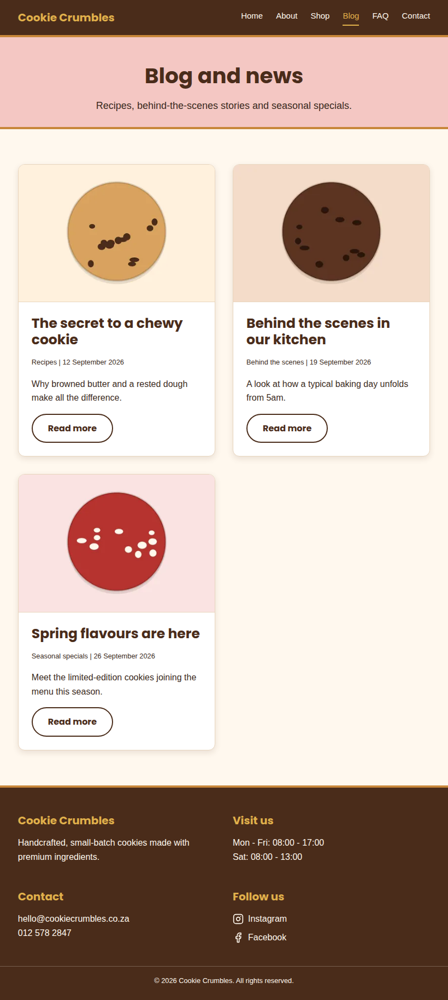 | 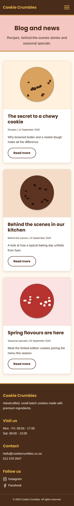 |
| FAQ | 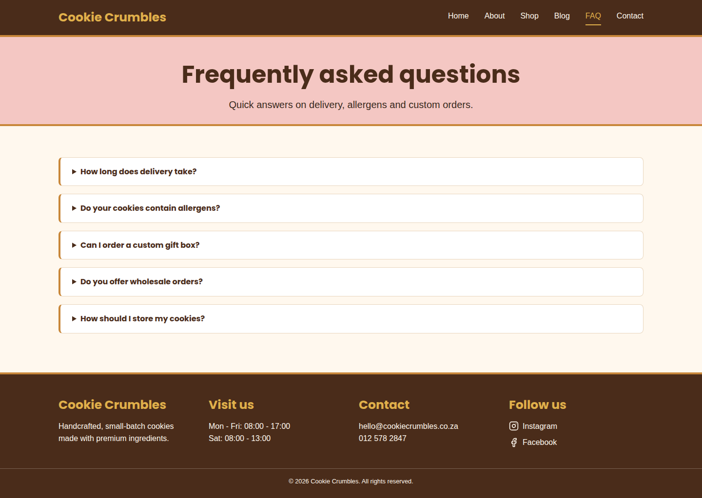 | 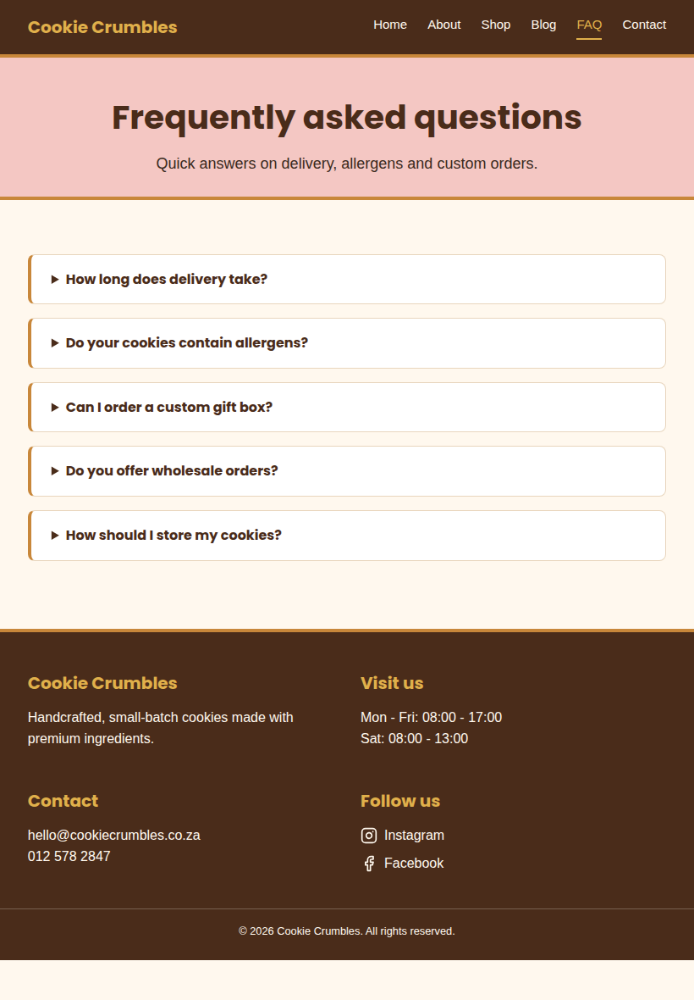 | 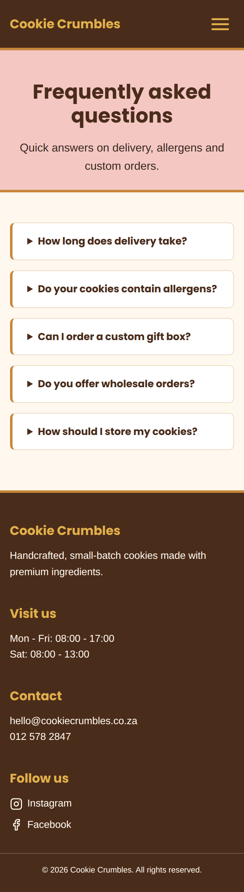 |
| Contact | 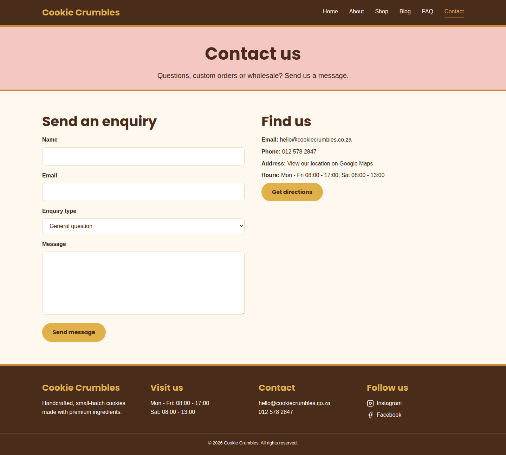 | 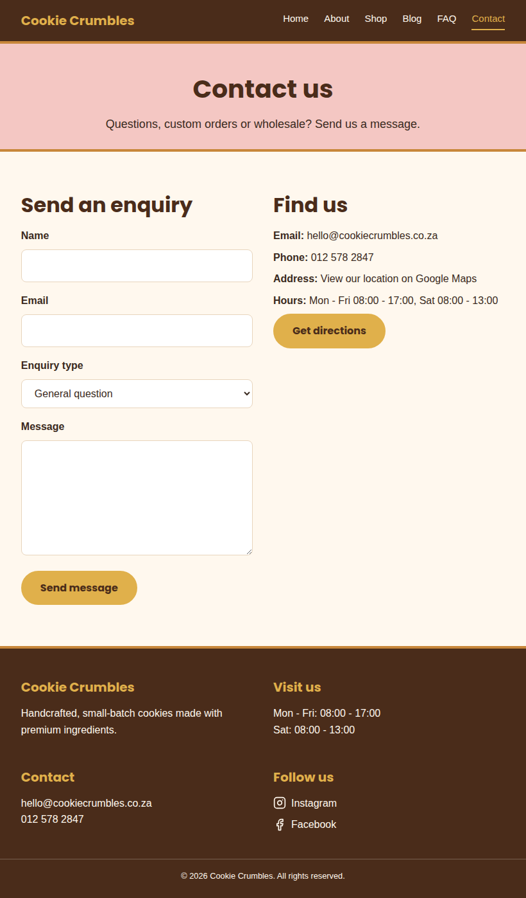 | 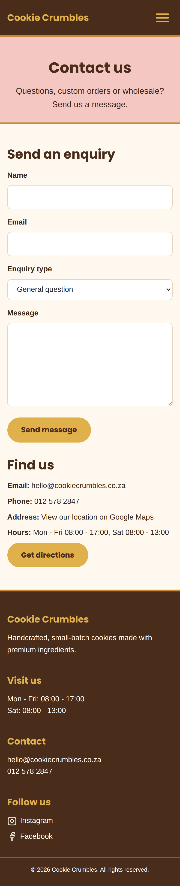 |

### Iteration

- The first version of the stylesheet only defined a desktop layout, so on a phone the content was too wide and the navigation did not fit. I rebuilt it mobile-first and added the tablet and desktop breakpoints.
- After each change I re-checked every page at every size above to make sure nothing scrolls sideways.
- The hero buttons were given a fixed shared width with a gap between them, and become full-width on small phones.

<!-- Add your own notes here: anything you tested and adjusted in Chrome DevTools, with the device you used. -->

## How to run

Download or clone the repository and open `index.html` in a browser. No build step or server is needed.
